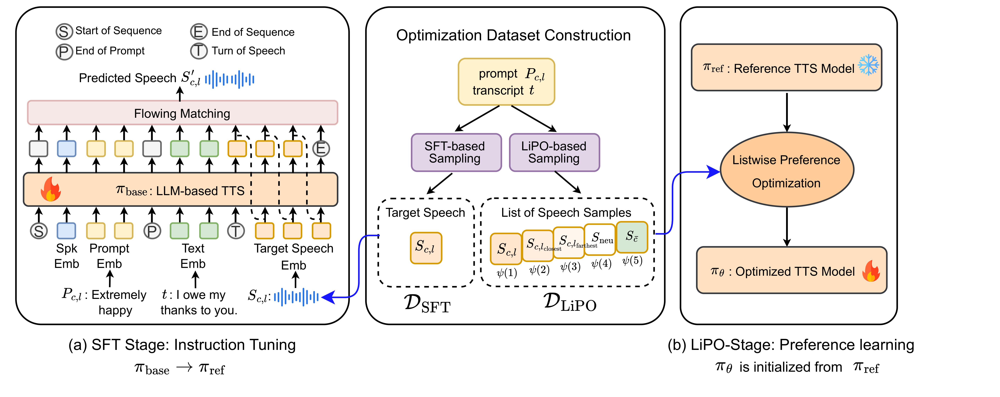

# Emo-LiPO: Listwise Preference Optimization for Fine-Grained Emotion Intensity Control in LLM-based Text-to-Speech

<p align="center">
  <a href="https://arxiv.org/abs/xxxx.xxxxx"></a>
  <a href="https://huggingface.co/datasets/hlt-cuhksz/ESD-plus"></a>
  
</p>

<p align="center">
  <b>IJCAI 2026</b>
</p>

<p align="center">
  <a href="#abstract">Abstract</a> |
  <a href="#method">Method</a> |
  <a href="#esd-plus-dataset">Dataset</a> |
  <a href="#installation">Installation</a> |
  <a href="#usage">Usage</a> |
  <a href="#citation">Citation</a>
</p>

---

## Abstract

Large language model (LLM)-based text-to-speech (TTS) systems enable prompt-conditioned emotional control but struggle with fine-grained emotion intensity due to the semantic-acoustic gap between text and speech. We propose **Emo-LiPO**, a listwise preference optimization framework that formulates emotion intensity control as a learning-to-rank problem and explicitly models global intensity ordering under fixed transcripts. We further introduce **ESD-plus**, a multi-speaker emotional speech dataset with explicit emotion intensity variations, to support fine-grained emotion modeling and evaluation. Experiments demonstrate that Emo-LiPO consistently outperforms supervised and DPO-based LLM TTS baselines in emotion accuracy and intensity controllability, while maintaining high speech quality.

## Method

<p align="center">
  
</p>

Emo-LiPO is built on [CosyVoice-300M-Instruct](https://github.com/FunAudioLLM/CosyVoice) and introduces a two-stage training pipeline:

**Stage 1: Supervised Fine-Tuning (SFT)**
Fine-tune the base CosyVoice model on emotion-labeled speech data (ESD-plus) to obtain the reference policy $\pi_{\text{ref}}$.

**Stage 2: Listwise Preference Optimization (LiPO)**
Optimize the model with listwise emotion intensity rankings. For each prompt $P_{c,l}$, we construct a preference list of $K+2$ candidates ranked by a rule-based strategy:

$$\mathcal{T}\_{c,l} = [S_{c,l} \succ S_{c,l_{\text{closest}}} \succ \cdots \succ S_{\text{neu}} \succ S_{\varepsilon}]$$

The preference label for each candidate is defined as:

$$\psi_{c,l}(i) = 1 - \frac{i-1}{K+2}, \quad i = 1, \ldots, K+2$$

The optimization objective uses an NDCG-inspired $\lambda$-weighting scheme to scale pairwise loss terms by intensity discrepancy:

$$\lambda_{i,j} = |G(i) - G(j)| \cdot \left|\frac{1}{D(i)} - \frac{1}{D(j)}\right|$$

where $G(i) = 2^{\psi(i)} - 1$ and $D(i) = \frac{1}{\log(1+i)}$.

## ESD-plus Dataset

**ESD-plus** is a multi-speaker emotional speech dataset with explicit intensity variations, built upon the English portion of the [ESD corpus](https://github.com/HLTSingapore/Emotional-Speech-Data).

| Property | Detail |
|----------|--------|
| Emotion Categories | Happy, Sad, Angry, Surprised, Neutral |
| Intensity Levels | Slightly, Moderately, Extremely |
| Total Labels | 13 (4 emotions x 3 levels + Neutral) |
| Total Samples | 45,500 |
| Speakers | 10 (4 male + 6 female) |
| Avg Duration | 2.92 seconds |
| Total Audio | ~36.89 hours |
| Split | 300 / 20 / 30 utterances (train / dev / test) |

Download: [ESD-plus on HuggingFace](https://huggingface.co/datasets/hlt-cuhksz/ESD-plus)

## Installation

### Requirements

- Python 3.8
- CUDA-compatible GPU (4x GPUs recommended for training)
- Conda

### Setup

```bash
git clone --recursive https://github.com/hlt-cuhksz/Emo-LiPO.git
cd Emo-LiPO
git submodule update --init --recursive
```

```bash
conda create -n cosyvoice python=3.8
conda activate cosyvoice
conda install -y -c conda-forge pynini==2.1.5
pip install -r requirements.txt -i https://mirrors.aliyun.com/pypi/simple/ --trusted-host=mirrors.aliyun.com
```

```bash
export PYTHONPATH=third_party/Matcha-TTS:$PYTHONPATH
```

### Pretrained Models

Download the CosyVoice-300M-Instruct pretrained model:

```python
from modelscope import snapshot_download
snapshot_download('iic/CosyVoice-300M-Instruct', local_dir='pretrained_models/CosyVoice-300M-Instruct')
```

## Usage

All training and inference scripts are located in `examples/libritts/cosyvoice/`. Run all commands from that directory:

```bash
cd examples/libritts/cosyvoice
```

### Data Preparation

Prepare the ESD-plus data in `data_ESD_intensity/` with the following structure:

```
data_ESD_intensity/
├── train/
│   ├── wav.scp          # utterance_id -> wav_path
│   ├── text             # utterance_id -> transcript
│   ├── utt2spk          # utterance_id -> speaker_id
│   └── spk2utt          # speaker_id -> utterance_ids
├── dev/
└── test/
```

**Step 1: Extract speaker embeddings**

```bash
bash run_stage_1.sh
```

**Step 2: Extract discrete speech tokens**

```bash
bash run_stage_2.sh
```

**Step 3: Prepare parquet training data**

```bash
# For SFT data
python tools/make_parquet_list_sft.py --num_utts_per_parquet 1000 \
    --num_processes 1 \
    --src_dir data_ESD_intensity/train \
    --des_dir data_ESD_intensity/train/parquet_sft

# For LiPO data (with rule-based ranking)
python tools/make_parquet_list_lipo.py --num_utts_per_parquet 1000 \
    --num_processes 1 \
    --src_dir data_ESD_intensity/train \
    --des_dir data_ESD_intensity/train/parquet_lipo_rule

# For DPO data (cross-emotion pairwise preferences)
python tools/make_parquet_list_dpo_cross_emo.py --num_utts_per_parquet 1000 \
    --num_processes 1 \
    --src_dir data_ESD_intensity/train \
    --des_dir data_ESD_intensity/train/parquet_dpo
```

### Training

#### Stage 1: SFT Training

Fine-tune CosyVoice-300M-Instruct on ESD-plus to obtain the reference model $\pi_{\text{ref}}$:

```bash
bash run_stage_5_sft.sh
```

The trained model will be saved to `exp/cosyvoice_sft/llm/torch_ddp/`.

#### Stage 2: LiPO Training (Ours)

Train with listwise preference optimization, initialized from the SFT checkpoint:

```bash
# Usage: bash run_stage_5_lipo.sh <ranking_type> <list_length> <lambda_mode> <data_suffix>
# Example:
bash run_stage_5_lipo.sh rule 5 index rule
```

**Arguments:**
| Argument | Options | Description |
|----------|---------|-------------|
| `ranking_type` | `rule`, `pitch`, `energy` | Strategy for constructing preference lists |
| `list_length` | `4`, `5`, `6`, `7` | Number of candidates in the preference list ($K+2$) |
| `lambda_mode` | `index`, `score`, `no_lambda` | $\lambda$-weighting scheme |
| `data_suffix` | e.g., `rule` | Suffix for the parquet data directory |

**Recommended configuration (default in paper):**
```bash
bash run_stage_5_lipo.sh rule 5 index rule
```

#### Baseline: DPO Training

```bash
bash run_stage_5_dpo.sh
```

### Inference

Generate speech with emotion intensity control:

```bash
# SFT inference
python cosyvoice/bin/inference_sft.py \
    --emotion_data data_ESD_intensity/test/emotion \
    --tts_text data_ESD_intensity/test/tts_text.json \
    --gpu 0 \
    --result_dir exp/inference_sft \
    --model_dir pretrained_models/CosyVoice-300M-Instruct

# LiPO / DPO inference (specify trained LLM checkpoint)
python cosyvoice/bin/inference_dpo.py \
    --emotion_data data_ESD_intensity/test/emotion \
    --tts_text data_ESD_intensity/test/tts_text.json \
    --gpu 0 \
    --result_dir exp/inference_lipo \
    --model_dir pretrained_models/CosyVoice-300M-Instruct \
    --llm exp/cosyvoice_lipo_rule_5_index_rule_5/llm/torch_ddp/epoch_best.pt
```

### Emotion Prompt Format

The model uses structured emotion prompts combining emotion category with intensity level:

```
<Emotion Intensity>.<endofprompt><transcript>
```

Supported emotion-intensity labels:

| ID | Label | ID | Label |
|----|-------|------|-------|
| 0  | Neutral | 31 | Slightly Sad |
| 11 | Slightly Angry | 32 | Moderately Sad |
| 12 | Moderately Angry | 33 | Extremely Sad |
| 13 | Extremely Angry | 41 | Slightly Surprised |
| 21 | Slightly Happy | 42 | Moderately Surprised |
| 22 | Moderately Happy | 43 | Extremely Surprised |
| 23 | Extremely Happy | | |

## Results

### Speech Quality & Emotion Relevance

| Model | WER $\downarrow$ | NISQA $\uparrow$ | DNSMOS $\uparrow$ | UTMOS $\uparrow$ | EmoSIM $\uparrow$ | Recall $\uparrow$ | Recall-ft $\uparrow$ |
|-------|------|-------|--------|-------|--------|--------|-----------|
| CosyVoice | 4.47 | 4.71 | 3.16 | **4.30** | 81.87 | 25.10 | 29.90 |
| Emo-DPO (E) | 4.78 | 4.66 | 3.23 | 4.06 | 91.73 | 24.08 | 34.92 |
| Emo-DPO (I) | 6.79 | 4.60 | 3.21 | 4.00 | 91.85 | 26.87 | 37.21 |
| **Emo-LiPO** | 4.26 | **4.79** | 3.26 | 4.18 | 91.93 | **27.56** | **39.54** |

## Project Structure

```
Emo-LiPO/
├── examples/libritts/cosyvoice/
│   ├── conf/                         # Training configs (YAML)
│   │   ├── cosyvoice_sft.yaml
│   │   ├── cosyvoice_dpo.yaml
│   │   └── cosyvoice_lipo.yaml
│   ├── cosyvoice/
│   │   ├── bin/                      # Training & inference entry points
│   │   ├── llm/                      # LLM model definitions
│   │   ├── dataset/                  # Data processing pipelines
│   │   └── utils/                    # Training utilities & executor
│   ├── tools/                        # Data preparation scripts
│   ├── run_stage_1.sh                # Extract speaker embeddings
│   ├── run_stage_2.sh                # Extract speech tokens
│   ├── run_stage_3.sh                # Make parquet data
│   ├── run_stage_5_sft.sh            # SFT training
│   ├── run_stage_5_dpo.sh            # DPO training
│   └── run_stage_5_lipo.sh           # LiPO training
├── tools/                            # Shared data preparation tools
├── third_party/Matcha-TTS/           # Flow matching dependency
└── pretrained_models/                # Downloaded pretrained models
```

## Acknowledgements

This project is built upon the following open-source works:

- [CosyVoice](https://github.com/FunAudioLLM/CosyVoice) - LLM-based TTS backbone
- [Matcha-TTS](https://github.com/shivammehta25/Matcha-TTS) - Flow matching for speech synthesis
- [emotion2vec](https://github.com/ddlBoJack/emotion2vec) - Emotion representation model
- [ESD](https://github.com/HLTSingapore/Emotional-Speech-Data) - Base emotional speech corpus
- [LiPO](https://arxiv.org/abs/2402.01878) - Listwise preference optimization framework

## Citation

```bibtex
@inproceedings{lin2026emolipo,
  title={Emo-LiPO: Listwise Preference Optimization for Fine-Grained Emotion Intensity Control in LLM-based Text-to-Speech},
  author={Lin, Yihang and Zhou, Li and Cao, Congwei and Xie, Dongchu and Gao, Xiaoxue and Zhang, Chen and Li, Haizhou},
  booktitle={Proceedings of the Thirty-Fifth International Joint Conference on Artificial Intelligence (IJCAI)},
  year={2026}
}
```

## License

This project is licensed under the [Apache License 2.0](LICENSE).

## Disclaimer

The content provided above is for academic purposes only and is intended to demonstrate technical capabilities. Some examples are sourced from the internet. If any content infringes on your rights, please contact us to request its removal.
